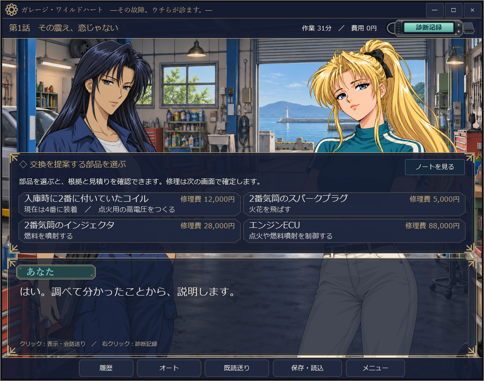

# ガレージ・ワイルドハート

.NETは同梱していません。[.NET 10 Desktop Runtime x64](https://dotnet.microsoft.com/ja-jp/download/dotnet/10.0)を別途インストールしてください。

**その故障、ウチらが診ます。**

舞台は、港町の小さな整備工場。新人として働き始めたあなたを待っているのは、頼れる先輩たちと、愛車の不調に悩むお客さんたちです。

話を聞き、車を調べ、仲間と相談しながら原因を探していく、日本語の故障診断ノベルゲームです。

## ダウンロード

**Windows 64bit版 / 日本語 / オフラインで遊べます。**

- **[ゲームをダウンロード（v1.10.33・ZIP・約96 MB）](https://github.com/mezon-web/GarageWildHeart-Releases/releases/download/v1.10.33/GarageWildHeart-1.10.33-win-x64.zip)**
- [遊び方](遊び方.md) · [更新内容](https://github.com/mezon-web/GarageWildHeart-Releases/releases/tag/v1.10.33)

## 今回の更新

修理候補の右上からノートを開き、証拠を読み返して同じ候補へ戻れるようにしました。診断ノートの配置とコイルの位置表示も整理し、タイトル画像を更新しています。

## どんなゲーム？

「アクセルを踏むと、車が震えるんです」

お客さんのひと言から、今日の仕事が始まります。どんなときに起きるのか、車には何が起きているのか。気になるところを調べて、ばらばらだった手がかりがつながる瞬間を探しましょう。

分からないことは、先輩たちに相談できます。専門用語やグラフの見方も、会話の中で一つずつ確かめながら進められます。自分で考えてみたいときは、必要なところだけヒントを聞くこともできます。

向き合うのは、事情の違う三台の車。作業の合間には仲間とのひと休みも。あなたがどう考え、どんな言葉を交わしたかによって、仕事の結末やその後の会話も変わります。

全3話の物語は、途中で保存して少しずつ遊べます。自分のペースで、ガレージでの一日を過ごしてください。

## ゲーム画面

プレイ画面です。

### 会話と選択肢

気になる手がかりを選び、何を確かめるかを先輩たちに相談します。お客さんの不安や、仲間のひと言への返し方にも選択肢があります。

### 診断と波形の比較

同じ条件で、部品を動かす前と後。グラフを並べて、どこに違いがあるかを仲間と一緒に確かめます。

### 証拠を整理するノート

「さっき分かったことは何だったっけ？」と思ったら、ノートを開いてみましょう。調べた結果を読み返しながら、次に何をするか考えられます。

### 証拠を見ながら修理を相談

部品の役割と費用を見比べ、気になったら右上の「ノートを見る」から証拠を確認できます。ノートを閉じても、会話や修理は進みません。

## 遊びはじめるには

1. 上の「ゲームをダウンロード」からZIPを保存します。
2. ZIPを右クリックして「すべて展開」を選びます。
3. 展開したフォルダーの `GarageWildHeart.exe` を開き、「はじめから」を選びます。

ゲームの画像・音声・シナリオは同梱しています。`GameData` フォルダーも必要なので、実行ファイルだけを別の場所へ移動せず、展開したフォルダーごと使ってください。

**「Source code (zip / tar.gz)」にはゲーム本体は入っていません。** 上のダウンロードリンクをご利用ください。

会話はクリックで読み進めます。文字の大きさ・速さや音量は「設定」で調整できます。詳しい操作や、保存データのバックアップ方法は[遊び方](遊び方.md)をご覧ください。

## 以前の版から遊んでいる方へ

ゲームを終了してから、新しいZIPを別のフォルダーへ展開してください。v1.10.25以降のセーブデータで続きから遊べます。v1.10.24以前の途中セーブは引き継げないため、「はじめから」で開始してください。

## 詳しい案内

- [遊び方・保存データ・ファイルの確認](遊び方.md)
- [v1.10.33の更新内容](release-notes/v1.10.33.md) · [過去の配布版](https://github.com/mezon-web/GarageWildHeart-Releases/releases)
- [動作確認について](検証.md) · [ZIPのSHA-256](https://github.com/mezon-web/GarageWildHeart-Releases/releases/download/v1.10.33/GarageWildHeart-1.10.33-win-x64.zip.sha256)

本作の車両や診断値は架空のものです。実車の整備には使用しないでください。

画像とBGMには生成AIを使用しています。ライセンスなどの詳しい情報は、同梱の「説明書」フォルダーと[制作素材とライセンスについて](遊び方.md#制作素材とライセンスについて)をご覧ください。

<!-- 次回公開時は版番号・ダウンロード直リンク・更新内容・検証範囲を更新する。匿名ダウンロードとSHA-256を確認する。GitHub Actionsは使用しない。 -->

