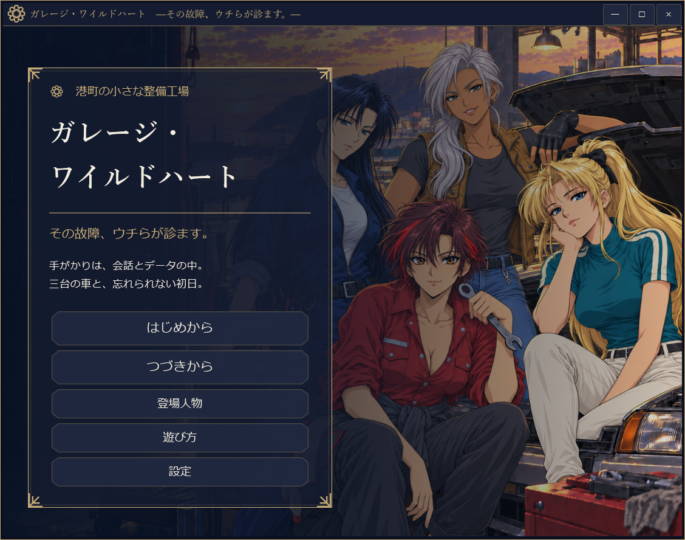
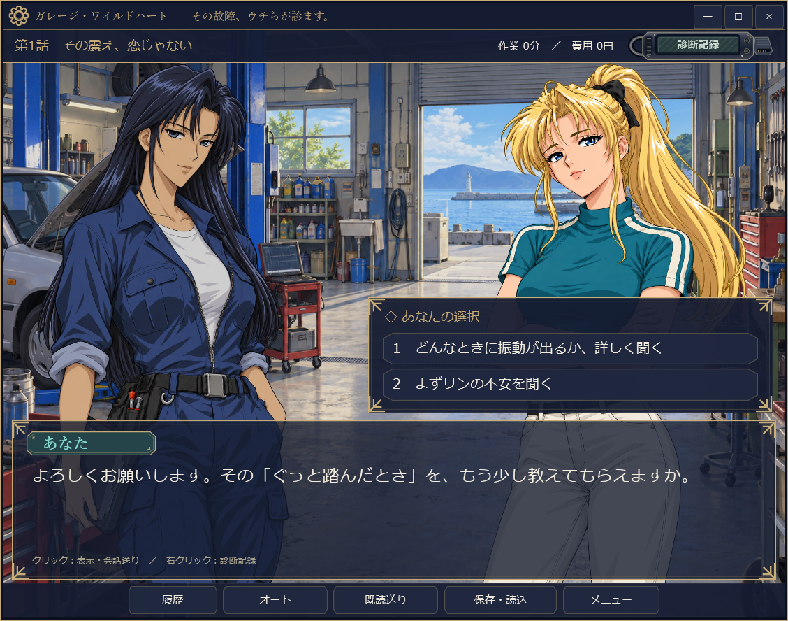
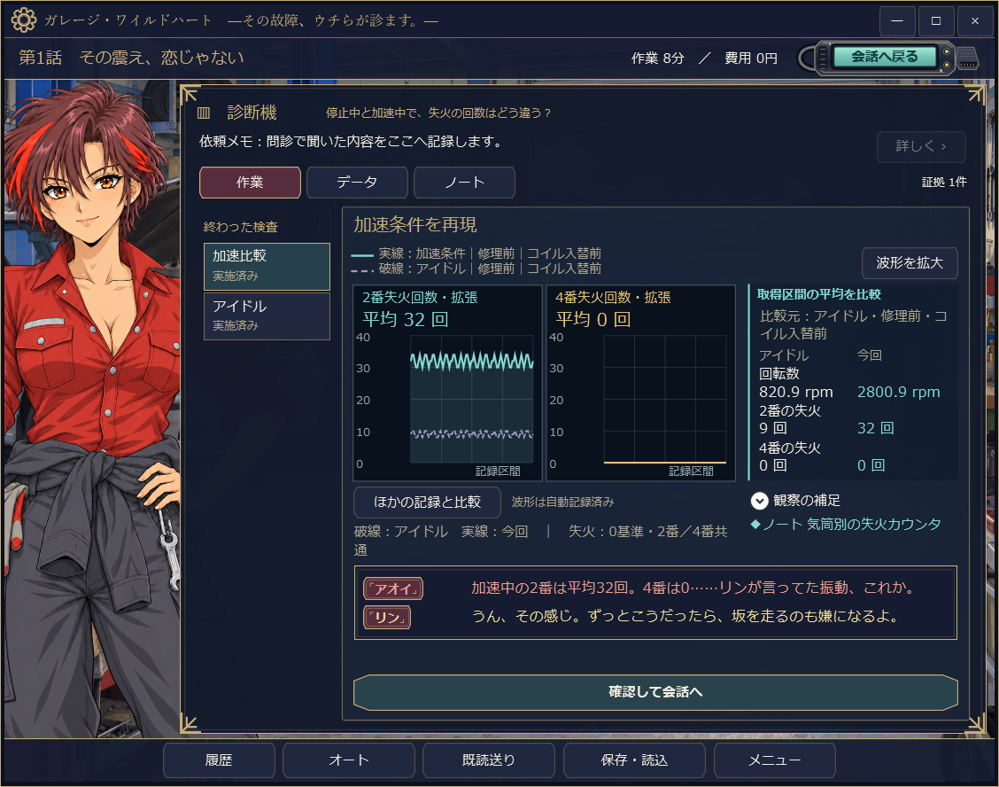
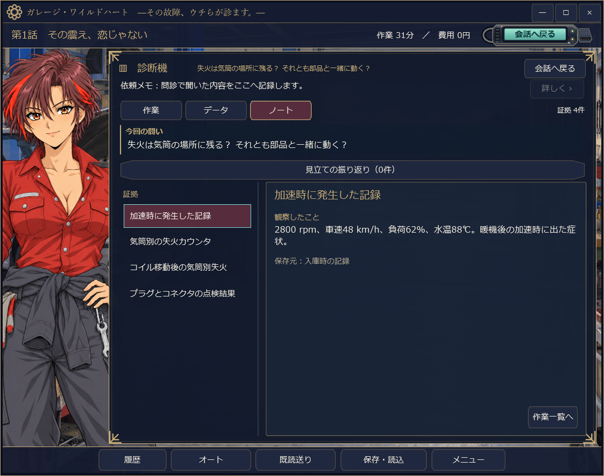

# ガレージ・ワイルドハート

**その故障、ウチらが診ます。**

港町の整備工場で、三台の車と四人の仲間に向き合う、日本語の故障診断ノベルゲームです。会話と検査で手がかりを集め、故障の原因と修理方針を考えます。Windows x64向け・オフラインで遊べます。

## ダウンロード

現在の公開版は **v1.10.28 / Windows x64** です。2026年11月2日に公開配布を開始しました。

- **[最新版をダウンロード（v1.10.28・ランタイム同梱ZIP）](https://github.com/mezon-web/GarageWildHeart-Releases/releases/download/v1.10.28/GarageWildHeart-1.10.28-win-x64.zip)**
- [ZIPのSHA-256](https://github.com/mezon-web/GarageWildHeart-Releases/releases/download/v1.10.28/GarageWildHeart-1.10.28-win-x64.zip.sha256)
- [更新内容](https://github.com/mezon-web/GarageWildHeart-Releases/releases/tag/v1.10.28) · [過去バージョン](https://github.com/mezon-web/GarageWildHeart-Releases/releases)
- [遊び方](遊び方.md) · [検証範囲](検証.md)



## 起動方法

1. 上のZIPをダウンロードし、書き込み可能なフォルダーへすべて展開します。
2. 展開先の `GarageWildHeart.exe` を起動します。
3. タイトル画面の「はじめから」で開始します。

.NETランタイムは同梱済みです。`GameData` フォルダーは実行ファイルと同じ場所に置いてください。操作説明・攻略チャート・依存ランタイムのライセンスは「説明書」フォルダーに入っています。

GitHubが自動表示する **Source code (zip / tar.gz)** は、この配布案内リポジトリの文書です。ゲーム本体は上の名前付きZIPをダウンロードしてください。このリポジトリでは、配布物と利用案内を公開しています。ゲームの開発ソースは含みません。

## どんなゲーム？

- プロローグと全3話の故障診断、4種類の結末、仲間それぞれの後日談。
- 会話で検査方針を選び、故障コード・波形・観察結果から原因を絞り込みます。
- 検査記録と証拠は自動でノートに残り、修理の根拠は自分で選びます。
- 説明を読みながら進める「案内あり」と、必要なときだけ相談する「自力・段階ヒント」。
- 手動保存5枠、オートセーブ、履歴、オート送り、文字・音量・演出の設定。

初回60〜90分を設計上の目安にしています。読む速さや検査の選び方によって変わります。車両・診断値はゲーム専用の架空設定です。実車の整備手順書としての使用は想定していません。

## ゲーム画面

v1.10.28の画面です。会話で聞き取りや検査方針を選び、診断データと集めた証拠を見ながら考えます。

### 会話と選択肢

症状を詳しく聞くか、まず相手の気持ちを聞くか。仲間との会話を通じて、次の行動を選びます。



### 診断と波形の比較

取得した波形を条件ごとに比較します。数値と仲間の反応を読みながら、どこに違いがあるかを確かめます。



### 証拠を整理するノート

検査で得た観察はノートへ自動記録されます。結果を読み返し、修理を提案する根拠を整理できます。



## 保存と更新

保存・設定は `%LOCALAPPDATA%\GarageWildHeart` に置かれます。更新するときはゲームを終了し、新しいZIPを別のフォルダーへ展開してください。

v1.10.28の保存形式は4です。v1.10.25以降の形式4の保存データを利用できます。v1.10.24以前の途中セーブは引き継がず、「はじめから」で開始してください。

## ファイルの確認

ZIPとSHA-256ファイルを保存し、PowerShellで値を照合できます。

```powershell
Get-FileHash -LiteralPath '.\GarageWildHeart-1.10.28-win-x64.zip' -Algorithm SHA256
Get-Content -LiteralPath '.\GarageWildHeart-1.10.28-win-x64.zip.sha256' -Encoding UTF8
```

画像には生成画像を、BGMにはACE-Step 1.5で制作したインスト曲を使用しています。ゲームの実行に画像・音楽の生成環境は不要です。同梱.NETのライセンスと第三者通知は「説明書」内の `dotnet-LICENSE.txt` と `dotnet-ThirdPartyNotices.txt` を参照してください。

## 更新履歴

- [v1.10.28 — 検査を省略・並べ替えた場合の会話を改善](release-notes/v1.10.28.md)

<!-- 次回公開時は版番号・ダウンロード直リンク・更新内容・検証範囲を更新する。匿名ダウンロードとSHA-256を確認する。GitHub Actionsは使用しない。 -->
